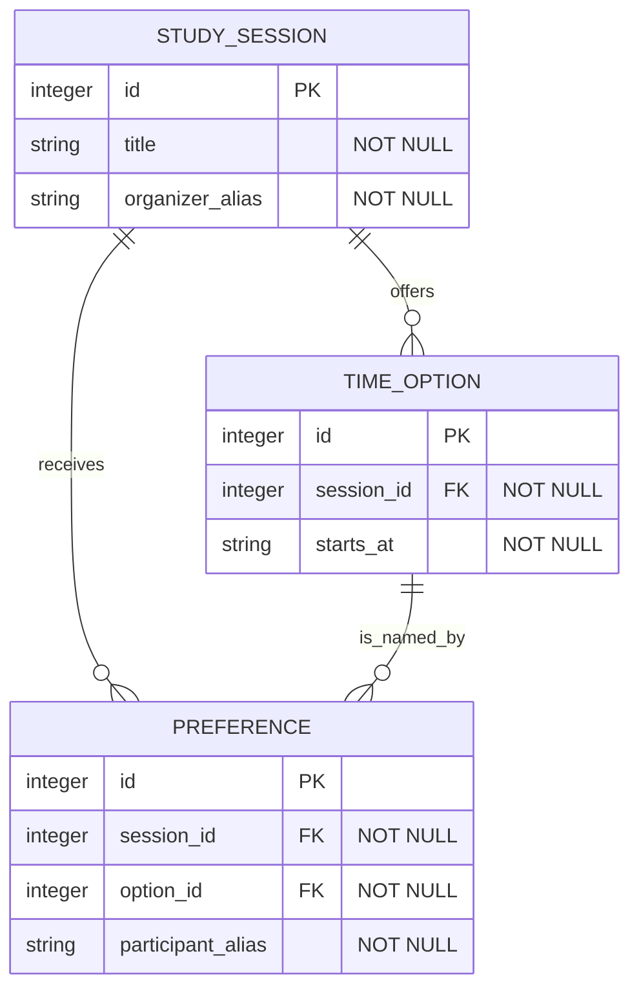
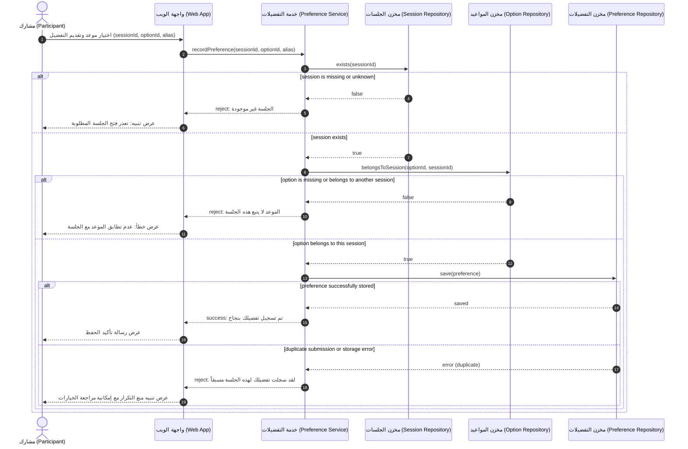

# Issue #56 — Group 06: ERD, DBML, Sequence, and Class diagrams

**Status:** Static curriculum review recorded; runtime evidence Not Run; group acceptance/release pending.
(This group is neither released nor marked improved until course-owner sign-off is completed. No curriculum author or agent review constitutes course-owner acceptance.)

**Group membership:** `relational-erd-design`, `dbml-dbdiagram-io`, `sequence-diagram-modeling`, `class-diagram-design` (Topics 14, 15, 16, 17). Canonical identities preserved. No access gates or prerequisite locks are introduced, and all published Topics remain accessible in the reader at `/learn/relational-erd-design`, `/learn/dbml-dbdiagram-io`, `/learn/sequence-diagram-modeling`, and `/learn/class-diagram-design`.

---

## 1. Course Owner Decision Status (DEC-50 & Package 70 v2)

| Item | Subject | Owner Disposition (2026-10-20) | Implementation Status |
|---|---|---|---|
| 1 | Group boundary & 58-Topic preservation | **Accepted** by MahmoudAlmodalal: 19 groups, all 58 canonical Topics preserved. | Confirmed: Group 06 comprises Topics 14, 15, 16, 17 (`relational-erd-design`, `dbml-dbdiagram-io`, `sequence-diagram-modeling`, `class-diagram-design`). |
| 2 | Lesson template | **Accepted** by MahmoudAlmodalal: lesson template in `docs/curriculum/` confirmed. | Confirmed: required template elements inspected in source for all 4 member Topics. |
| 3 | Quiz scoring policy | **Accepted** by MahmoudAlmodalal: 1 point per correct answer, 0 for incorrect/unanswered, unlimited retries, feedback after submit, all attempts retained with versions. | The policy is accepted in DEC-70; runtime scoring, retries, feedback, and attempt retention are Not Run in this packet. |
| 4 | Practical self-assessment policy | **Accepted** by MahmoudAlmodalal: self-reported levels `not-yet`, `in-progress`, `ready-for-review`, no mastery threshold, no independent correctness claim. | Rubric scale matches policy; DEC-70 accepts the self-reported scale; learner ratings do not assert independent correctness. |
| 5 | External video candidates | **Deferred** by MahmoudAlmodalal: candidate representation accepted, but individual video approval deferred pending human check of playback/captions/accessibility. | All 4 Topics retain researched candidate entries with discovery evidence; none claimed as approved. |
| 6 | Group release / improved status | **Accepted** by MahmoudAlmodalal: group may be announced as improved only after complete evidence is recorded, independently verified, and signed off centrally. | This packet does not establish complete evidence or group acceptance; independent verification and end-of-queue owner sign-off remain pending. |

---

## 2. Topic-by-Topic Walkthrough and Verification Ledger

**Review boundary:** The verdicts below record static source/educational inspection only. They do not attest to browser behavior, external-tool execution, learner artifacts, independent verification of a release candidate, or owner acceptance. Runtime state is recorded separately as Not Run.

### Topic 14: `relational-erd-design` (Sequence Position 14)
- **Reviewer:** Curriculum Reviewer (agent/issue-56) & independent question/rubric review by `root`
- **Review Date:** 2026-10-20

| Element | Required Item | Inspected Content & Evidence | Verdict |
|---|---|---|---|
| **Learning Objectives** | Clear objectives with stable semantic IDs | Two stable objectives: `erd-objective-keys` (تصميم جداول ومفاتيح وقيود تدعم حقائق المجال المعتمدة) and `erd-objective-integrity` (مراجعة العلاقات والتكامل المرجعي والتزامن مقابل سيناريوهات المنتج). | **Static review: present** |
| **Inputs & Prerequisites** | Clear starting context and minimal prerequisites without access locks | Stated clearly: PRD (`docs/PRD.md`), User Flow (`docs/user-flow.md`), and Domain Model (`docs/diagrams/domain-model.md`). All topics remain directly accessible with no prerequisite lock. | **Static review: present** |
| **Explanation** | Real explanation of concepts, boundaries, and technical decisions | Explains differences between Domain Model and ERD (conceptual vs relational, no PK/FK in domain model vs mandatory PK/FK in ERD, SQL types, naming conventions). Details 6 core pillars (Table, PK, FK, Cardinality 1:1/1:N/N:M, Constraints NOT NULL/UNIQUE/CHECK, 3NF normalization) and concurrency/race condition analysis with the atomic inventory formula. | **Static review: present** |
| **Worked Example** | Concrete worked example with BorrowHub explicitly optional | Section 4 provides BorrowHub relational model (`users`, `equipment_categories`, `equipment`, `loan_requests`, `loan_action_logs`) with Mermaid `erDiagram`. Accompanied by prominent disclaimer callout designating BorrowHub as an optional modeling example, not an approved production schema. | **Static review: present** |
| **Practical Steps** | Actionable steps for the learner's own project with concrete outputs | Step 1 guides converting domain concepts into tables, keys, and constraints with documented rationale into `docs/ERD.md`. Step 2 guides auditing concurrency scenarios into `docs/database-review.md`. | **Static review: present** |
| **Exercise & Prompt** | Guided exercise and copyable review prompts | PROMPT 12 (Relational ERD generation in DBML and Mermaid) and PROMPT 13 (Database quality and concurrency review). Prompt text and copy affordance are present in source; clipboard interaction is Not Run. | **Static review: present** |
| **Expected Outputs** | Declared outputs linking to next topic without locks | Declared outputs: `erd-doc` (`docs/ERD.md`) and `database-review` (`docs/database-review.md`). Supplies documented handoff to Topic 15 (DBML) without access locks. | **Static review: present** |
| **Objective Quiz** | Stable question IDs, 4 options, key, explanation, policy compliance | Questions `erd-q-fk` (foreign key role) and `erd-q-concurrency` (handling race condition). Question keys and explanations were inspected statically; grading, retries, and runtime feedback are Not Run. | **Static review: present** |
| **Checklist & Rubric** | Practical checklist and artifact-bound rubric criteria | 6 checklist items. Rubric criteria `erd-r-integrity` -> `erd-doc` and `erd-r-concurrency` -> `database-review`. Rubric criteria and scale were inspected statically; editing and reload persistence are Not Run. | **Static review: present** |
| **External Video Candidate** | Researched candidate with URL, purpose, and discovery evidence | Candidate: Lucidchart ERD tutorial (`https://help.lucid.co/hc/en-us/articles/16471565238292-Create-an-Entity-Relationship-Diagram-in-Lucidchart`). Status: Candidate; playback/captions unverified; offline playback disclaimed. | **Candidate recorded; individual human approval Not Run** |
| **Diagram Modeling** | Rendered architectural diagram | Mermaid `erDiagram` source with entities, attributes, primary/foreign keys, and cardinalities is present; renderer execution is Not Run. | **Static review: present** |

---

### Topic 15: `dbml-dbdiagram-io` (Sequence Position 15)
- **Reviewer:** Curriculum Reviewer (agent/issue-56) & independent question/rubric review by `root`
- **Review Date:** 2026-10-20

| Element | Required Item | Inspected Content & Evidence | Verdict |
|---|---|---|---|
| **Learning Objectives** | Clear objectives with stable semantic IDs | Two stable objectives: `dbml-objective-translate` (كتابة مخطط DBML يعكس ERD المعتمد مع أنواع الحقول والمراجع) and `dbml-objective-export` (تصيير ومراجعة المخطط وتصدير SQL مع فهم اختلافه عن DBML). | **Static review: present** |
| **Inputs & Prerequisites** | Clear starting context and minimal prerequisites without access locks | Stated input: Accepted ERD (`docs/ERD.md`). Prerequisite is purely instructional with no access locks. | **Static review: present** |
| **Explanation** | Real explanation of concepts, boundaries, and technical decisions | Defines DBML as a declarative schema markup language. Highlights the crucial distinction: DBML is NOT Mermaid (cannot be rendered in Mermaid Live). Details DBML syntax (`Table`, `Ref`, `Note`, indexes, default values) and step-by-step dbdiagram.io workflow including interactive links and SQL DDL export. | **Static review: present** |
| **Worked Example** | Concrete worked example with BorrowHub explicitly optional | Section 4 provides complete copyable BorrowHub DBML code with `Table users`, `equipment_categories`, `equipment`, `loan_requests`, `loan_action_logs`, and explicit `Ref` relations. Labeled as optional educational case study. | **Static review: present** |
| **Practical Steps** | Actionable steps for the learner's own project with concrete outputs | Step 1 translates approved ERD into local `docs/database.dbml`. Step 2 reviews layout in dbdiagram.io and exports `docs/database.sql` DDL. | **Static review: present** |
| **Exercise & Prompt** | Guided exercise and copyable prompts | Step-by-step dbdiagram.io application guide and copyable DBML code snippet. Prompt text and copy affordance are present in source; clipboard interaction is Not Run. | **Static review: present** |
| **Expected Outputs** | Declared outputs linking to next topic without locks | Declared outputs: `dbml-source` (`docs/database.dbml`) and `sql-export` (`docs/database.sql`). Explicit note that interactive links/exports require actual execution, otherwise recorded as Not Run. | **Static review: present** |
| **Objective Quiz** | Stable question IDs, 4 options, key, explanation, policy compliance | Questions `dbml-q-language` (DBML vs SQL) and `dbml-q-export` (reviewing exported DDL before use). Keys and rationales inspected statically; question keys and explanations were inspected statically; grading and runtime feedback are Not Run. | **Static review: present** |
| **Checklist & Rubric** | Practical checklist and artifact-bound rubric criteria | 5 checklist items. Rubric criteria `dbml-r-fidelity` -> `dbml-source` and `dbml-r-export` -> `sql-export`. Rubric criteria and scale were inspected statically; editing and reload persistence are Not Run. | **Static review: present** |
| **External Video Candidate** | Researched candidate with URL, purpose, and discovery evidence | Candidate: Fazt dbdiagram.io tutorial (`https://www.youtube.com/watch?v=yN1RnjZEosY`). Status: Candidate; third-party Spanish creator; playback/captions unverified; offline playback disclaimed. | **Candidate recorded; individual human approval Not Run** |
| **Diagram Modeling** | Rendered architectural diagram | DBML source and a manually authored SQL comparison are present; dbdiagram.io rendering and actual SQL export are Not Run. | **Static review: present** |

---

### Topic 16: `sequence-diagram-modeling` (Sequence Position 16)
- **Reviewer:** Curriculum Reviewer (agent/issue-56) & independent question/rubric review by `root`
- **Review Date:** 2026-10-20

| Element | Required Item | Inspected Content & Evidence | Verdict |
|---|---|---|---|
| **Learning Objectives** | Clear objectives with stable semantic IDs | Two stable objectives: `sequence-objective-order` (تمثيل رسائل متتابعة زمنياً بين الأطراف والخدمات في حالة استخدام محددة) and `sequence-objective-branches` (إظهار التحقق والنجاح وفروع الخطأ على أساس SRS). | **Static review: present** |
| **Inputs & Prerequisites** | Clear starting context and minimal prerequisites without access locks | Inputs: PRD (`docs/PRD.md`), Use Cases, User Flow (`docs/user-flow.md`), and ERD (`docs/ERD.md`). Non-blocking guidance. | **Static review: present** |
| **Explanation** | Real explanation of concepts, boundaries, and technical decisions | Explains dynamic interaction modeling answering "who sends what, to whom, and in what chronological order". Establishes architectural rule: Logical Participants (Actor, WebApp, Logic/Service, Data Store) vs speculative backends. Details Mermaid `sequenceDiagram` syntax (`actor`, `participant`, synchronous `->>`, response `-->>`, and `alt/else` conditional blocks). | **Static review: present** |
| **Worked Example** | Concrete worked example with BorrowHub explicitly optional | Section 4 documents the equipment loan request interaction in BorrowHub: Actor Student, WebApp, LoanService, DB. Models user account check, active loans limit check (Rule 3: < 2), atomic inventory check and update, and conditional branches for failure and success. Labeled as optional case study. | **Static review: present** |
| **Practical Steps** | Actionable steps for the learner's own project with concrete outputs | Step 1 creates sequential interaction for a primary acceptance scenario (`docs/diagrams/sequence-diagrams.mmd`). Step 2 documents validation points, error branches, and acceptance criteria in `docs/diagrams/sequence-diagrams.md`. | **Static review: present** |
| **Exercise & Prompt** | Guided exercise and copyable prompts | PROMPT 09 (Sequence Diagram generation for main MVP use cases). Copyable prompt source is present; browser copy behavior is Not Run. | **Static review: present** |
| **Expected Outputs** | Declared outputs linking to next topic without locks | Declared outputs: `sequence-code` (`docs/diagrams/sequence-diagrams.mmd`) and `sequence-doc` (`docs/diagrams/sequence-diagrams.md`). Supplies documented handoff to Topic 17 (Class Diagram) without access locks. | **Static review: present** |
| **Objective Quiz** | Stable question IDs, 4 options, key, explanation, policy compliance | Questions `sequence-q-order` (vertical axis represents time and message sequence) and `sequence-q-alt` (purpose of alt branch for conditional responses). Keys and rationales inspected statically; question keys and explanations were inspected statically; grading and runtime feedback are Not Run. | **Static review: present** |
| **Checklist & Rubric** | Practical checklist and artifact-bound rubric criteria | 6 checklist items. Rubric criteria `sequence-r-order` -> `sequence-code` and `sequence-r-branches` -> `sequence-doc`. Rubric criteria and scale were inspected statically; editing and reload persistence are Not Run. | **Static review: present** |
| **External Video Candidate** | Researched candidate with URL, purpose, and discovery evidence | Candidate: University of Hamburg Lecture2Go sequence diagram lecture (`https://lecture2go.uni-hamburg.de/en/l2go/-/get/v/42264`). Status: Candidate; German language lecture; playback/captions unverified; offline playback disclaimed. | **Candidate recorded; individual human approval Not Run** |
| **Diagram Modeling** | Rendered architectural diagram | Mermaid `sequenceDiagram` source with `autonumber`, `actor`, `participant`, and `alt/else` blocks is present; renderer execution is Not Run. | **Static review: present** |

---

### Topic 17: `class-diagram-design` (Sequence Position 17)
- **Reviewer:** Curriculum Reviewer (agent/issue-56) & independent question/rubric review by `root`
- **Review Date:** 2026-10-20

| Element | Required Item | Inspected Content & Evidence | Verdict |
|---|---|---|---|
| **Learning Objectives** | Clear objectives with stable semantic IDs | Two stable objectives: `class-objective-structure` (اشتقاق أصناف وخصائص ومسؤوليات من بنية المجال والسلوك) and `class-objective-consistency` (مطابقة العلاقات مع ERD والعمليات مع مخطط التسلسل). | **Static review: present** |
| **Inputs & Prerequisites** | Clear starting context and minimal prerequisites without access locks | Inputs: ERD (`docs/ERD.md`), Sequence Diagrams (`docs/diagrams/sequence-diagrams.md`), and PRD (`docs/PRD.md`). Non-blocking guidance. | **Static review: present** |
| **Explanation** | Real explanation of concepts, boundaries, and technical decisions | Details object-oriented structural modeling. Explains architectural dependency order: why Class Diagram must follow ERD and Sequence (ERD supplies data attributes; Sequence justifies operations/methods). Covers visibility indicators (`+`, `-`, `#`, `~`), relationship semantics (Inheritance `<|--`, Composition `*--`, Aggregation `o--`, Association `-->`), and cross-diagram naming consistency matrix. | **Static review: present** |
| **Worked Example** | Concrete worked example with BorrowHub explicitly optional | Section 4 documents BorrowHub class diagram: `UserRole`, `UserStatus`, `LoanStatus` enums, `User`, `EquipmentCategory`, `Equipment`, `LoanRequest`, `LoanActionLog` classes with methods mapped to Sequence interactions. Labeled as optional case study. | **Static review: present** |
| **Practical Steps** | Actionable steps for the learner's own project with concrete outputs | Step 1 derives classes, attributes from ERD, and methods from Sequence into `docs/diagrams/class-diagram.mmd`. Step 2 audits relationships against ERD and methods against Sequence into `docs/diagrams/class-diagram.md`. | **Static review: present** |
| **Exercise & Prompt** | Guided exercise and copyable prompts | PROMPT 11 (Class Diagram Generation) and cross-diagram consistency mapping table. Copyable prompt source is present; browser copy behavior is Not Run. | **Static review: present** |
| **Expected Outputs** | Declared outputs linking to next topic without locks | Declared outputs: `class-code` (`docs/diagrams/class-diagram.mmd`) and `class-doc` (`docs/diagrams/class-diagram.md`). Supplies documented handoff to the next architectural phase. | **Static review: present** |
| **Objective Quiz** | Stable question IDs, 4 options, key, explanation, policy compliance | Questions `class-q-source` (using ERD to verify data relationships) and `class-q-responsibility` (justifying method assignment based on interaction and model). Keys and rationales inspected statically; question keys and explanations were inspected statically; grading and runtime feedback are Not Run. | **Static review: present** |
| **Checklist & Rubric** | Practical checklist and artifact-bound rubric criteria | 6 checklist items. Rubric criteria `class-r-structure` -> `class-code` and `class-r-alignment` -> `class-doc`. Rubric criteria and scale were inspected statically; editing and reload persistence are Not Run. | **Static review: present** |
| **External Video Candidate** | Researched candidate with URL, purpose, and discovery evidence | Candidate: Lucidchart Class Diagram tutorial (`https://lucid.co/diagram/uml/class-diagram-tutorial`). Status: Candidate; playback/captions unverified; offline playback disclaimed. | **Candidate recorded; individual human approval Not Run** |
| **Diagram Modeling** | Rendered architectural diagram | Mermaid `classDiagram` source with enums, classes, attributes, methods, and multiplicities is present; renderer execution is Not Run. | **Static review: present** |

---

## 3. Synthetic Illustrative Desk Reconstruction (Not Learner or Service Output)

The following cohesive text examples are a synthetic desk reconstruction authored for this review packet, using a fictional scheduling project. They were not produced by a learner, database tool, diagram renderer, or browser session, and they are not verified project artifacts. `docs/database.dbml` is sample text only; no dbdiagram.io rendering, link, or export was run. Any SQL shown is a manually written comparison, not generated DDL. Topic 15 still requires the learner to render and review DBML and assess an actual exported DDL artifact against the approved ERD. That required execution and artifact review are **Not Run / incomplete** here; `dbml-r-export` is unmet.

### 3.1 `docs/ERD.md` — Topic 14

```markdown
# Relational Design Exercise — Study-Group Scheduler

Provisional entities: STUDY_SESSION, TIME_OPTION, PREFERENCE.
Cardinalities: Each option belongs to one session; each participant alias submits at most one preference per session.
The minimum number of options per session is zero during drafting.



The ERD marks each primary key (PK) and foreign key (FK), and expresses one-to-many relationships.
The composite constraint ensuring `PREFERENCE.(session_id, option_id)` references `TIME_OPTION.(session_id, id)` is represented in DBML.
```

### 3.2 `docs/database-review.md` — Topic 14

```markdown
# Database Quality & Concurrency Review — Study-Group Scheduler

| Scenario / Constraint | What the Draft Protects | Remaining Risk or Open Question |
|---|---|---|
| Preference references an option from the same session | The composite `(session_id, option_id)` foreign key prevents cross-session references. | DBML syntax and generated DDL require engine-specific parser check. |
| Duplicate submissions by same alias | `UNIQUE(session_id, participant_alias)` allows at most one preference per alias/session pair. | Alias is not verified identity; edit/retry policy remains open. |
| Two submissions race concurrently | The unique constraint preserves the one-row invariant in target database. | Application-level retry/conflict response remains an open decision. |
| Equal preferences for two options | No schema constraint picks a winner. | Tie-handling rule must be decided by product owner. |
| Timezone & format for meeting time | String field stores text value. | ISO-8601 UTC timestamp conversion required before production. |
```

### 3.3 `docs/database.dbml` — Topic 15

```dbml
Table study_session {
  id integer [pk]
  title varchar [not null]
  organizer_alias varchar [not null]

  Note: 'جلسات الدراسة المنظمة'
}

Table time_option {
  id integer [pk]
  session_id integer [not null]
  starts_at varchar [not null, note: 'ISO-8601 timestamp string']

  indexes {
    (session_id, id) [unique]
  }

  Note: 'المواعيد المقترحة للجلسة'
}

Table preference {
  id integer [pk]
  session_id integer [not null]
  option_id integer [not null]
  participant_alias varchar [not null]

  indexes {
    (session_id, participant_alias) [unique]
  }

  Note: 'تفضيلات المشاركين للجلسة والموعد'
}

Ref: time_option.session_id > study_session.id [delete: cascade]
Ref: preference.session_id > study_session.id [delete: cascade]
Ref: preference.(session_id, option_id) > time_option.(session_id, id) [delete: cascade]
```

### 3.4 `docs/database.sql` — Topic 15 (Transcribed Comparison Preview)

```sql
PRAGMA foreign_keys = ON;

CREATE TABLE study_session (
  id INTEGER PRIMARY KEY,
  title VARCHAR NOT NULL,
  organizer_alias VARCHAR NOT NULL
);

CREATE TABLE time_option (
  id INTEGER PRIMARY KEY,
  session_id INTEGER NOT NULL,
  starts_at VARCHAR NOT NULL,
  UNIQUE (session_id, id),
  FOREIGN KEY (session_id) REFERENCES study_session(id) ON DELETE CASCADE
);

CREATE TABLE preference (
  id INTEGER PRIMARY KEY,
  session_id INTEGER NOT NULL,
  option_id INTEGER NOT NULL,
  participant_alias VARCHAR NOT NULL,
  UNIQUE (session_id, participant_alias),
  FOREIGN KEY (session_id) REFERENCES study_session(id) ON DELETE CASCADE,
  FOREIGN KEY (session_id, option_id)
    REFERENCES time_option(session_id, id) ON DELETE CASCADE
);
```

### 3.5 `docs/diagrams/sequence-diagrams.mmd` & `.md` — Topic 16



### 3.6 `docs/diagrams/class-diagram.mmd` & `.md` — Topic 17


| Sequence Message | Class Operation | Architectural Trace |
|---|---|---|
| `recordPreference(sessionId, optionId, alias)` | `PreferenceService.recordPreference(...)` | Accepts proposed preference from WebApp and coordinates validation. |
| `exists(sessionId)` | `SessionRepository.exists(...)` | Enforces prerequisite existence before recording. |
| `belongsToSession(optionId, sessionId)` | `OptionRepository.belongsToSession(...)` | Validates composite same-session invariant before persistence. |
| `save(preference)` | `PreferenceRepository.save(...)` | Persists valid preference entity atomically. |

---


## 4. Static Review Findings, Verification State, and Handoffs

Static review found the lesson sequence educationally coherent: Topic 14's ERD decisions feed Topic 15's DBML translation; the reviewed schema and requirements inform Topic 16's sequence interactions; Topic 16's behavior and the ERD constrain Topic 17's classes and methods. The BorrowHub example is optional. The fictional scheduler snippets above illustrate documentation structure only and do not satisfy the learner's artifact criteria.

| Evidence item | Status in this packet |
|---|---|
| Topic records, objectives, explanations, questions, expected outputs, and handoffs | Static content review recorded; this is not runtime verification. |
| dbdiagram.io source render, shared reference link, actual SQL DDL export, and rubric assessment of reviewed DDL | **Not Run / incomplete.** Required output remains an actual reviewed DDL artifact; a manually written SQL comparison is not a substitute. |
| Mermaid rendering and browser reader behavior | **Not Run** by this packet. |
| Lint/typecheck, unit tests, production build, Playwright, responsive/RTL visual inspection, copy, persistence, and accessibility behavior | **Not Run** by this packet; integrated candidate checks are owned by the root orchestrator. |
| Human approval of the individual video candidates | **Deferred** under DEC-70; no video is approved. |
| Independent exact-candidate review and inclusion on the end-of-queue owner sign-off list | **Pending**; this group is not improved or released. |

**Learner handoffs:** Topic 14 produces an ERD and database decision review for Topic 15. Topic 15 requires DBML fidelity plus an actual render/export and reviewed DDL before handing the schema forward. Topic 16 produces a message sequence and branch/acceptance notes for Topic 17. Topic 17 checks class structure and responsibilities against both upstream diagrams. All topics remain open; unmet artifacts remain learner work rather than access gates.

**Release status:** Group 06 is **not marked improved or released**. DEC-70 accepts the lesson template, quiz policy, and descriptive self-assessment policy. Group acceptance remains contingent on complete evidence, independent verification, resolved required-output gaps, and explicit inclusion in the course owner's end-of-queue sign-off list.