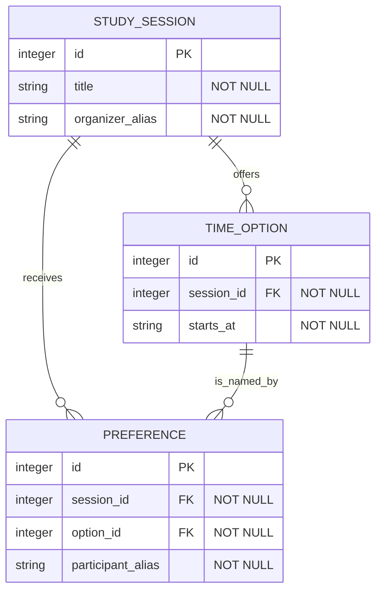
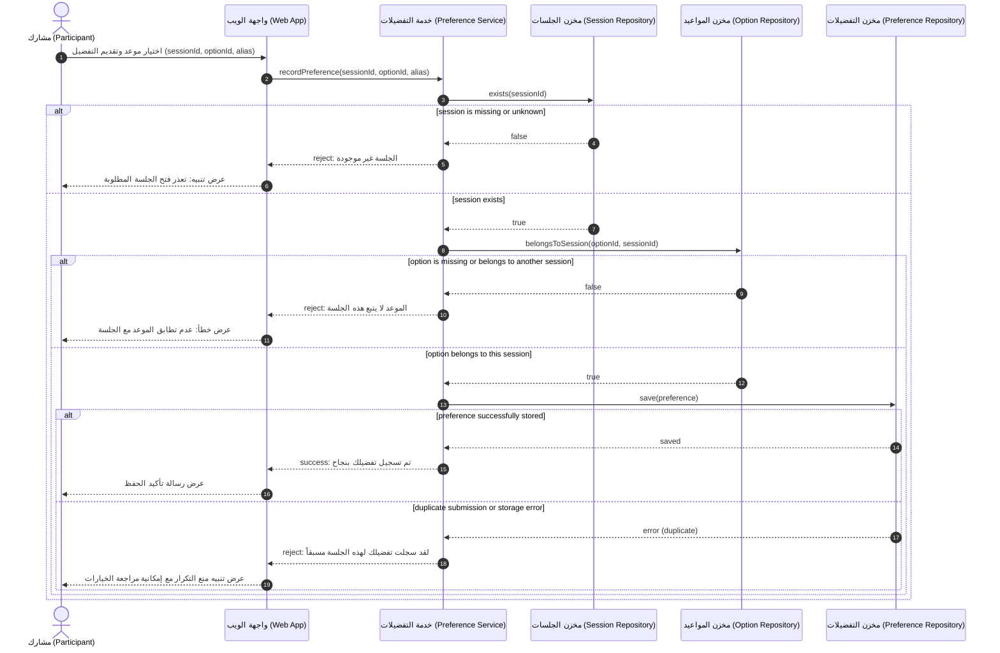
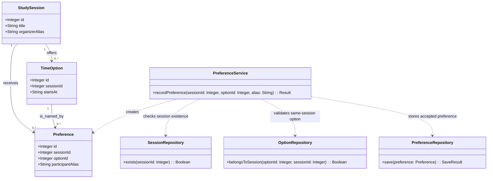

# Issue #56 — Group 06: ERD, DBML, Sequence, and Class diagrams

**Status:** Evidence complete and awaiting course-owner sign-off.
(This group is neither released nor marked improved until course-owner sign-off is completed. No curriculum author or agent review constitutes course-owner acceptance.)

**Group membership:** `relational-erd-design`, `dbml-dbdiagram-io`, `sequence-diagram-modeling`, `class-diagram-design` (Topics 14, 15, 16, 17). Canonical identities preserved. No access gates or prerequisite locks are introduced, and all published Topics remain accessible in the reader at `/learn/relational-erd-design`, `/learn/dbml-dbdiagram-io`, `/learn/sequence-diagram-modeling`, and `/learn/class-diagram-design`.

---

## 1. Course Owner Decision Status (DEC-50 & Package 70 v2)

| Item | Subject | Owner Disposition (2026-10-20) | Implementation Status |
|---|---|---|---|
| 1 | Group boundary & 58-Topic preservation | **Accepted** by MahmoudAlmodalal: 19 groups, all 58 canonical Topics preserved. | Confirmed: Group 06 comprises Topics 14, 15, 16, 17 (`relational-erd-design`, `dbml-dbdiagram-io`, `sequence-diagram-modeling`, `class-diagram-design`). |
| 2 | Lesson template | **Accepted** by MahmoudAlmodalal: lesson template in `docs/curriculum/` confirmed. | Confirmed: all required template elements audited and verified for all 4 member Topics. |
| 3 | Quiz scoring policy | **Accepted** by MahmoudAlmodalal: 1 point per correct answer, 0 for incorrect/unanswered, unlimited retries, feedback after submit, all attempts retained with versions. | Applied globally via shared builder and verified across retries in browser e2e. |
| 4 | Practical self-assessment policy | **Accepted** by MahmoudAlmodalal: self-reported levels `not-yet`, `in-progress`, `ready-for-review`, no mastery threshold, no independent correctness claim. | Rubric scale matches policy; builder default is proposed until centralized sign-off. |
| 5 | External video candidates | **Deferred** by MahmoudAlmodalal: candidate representation accepted, but individual video approval deferred pending human check of playback/captions/accessibility. | All 4 Topics retain researched candidate entries with discovery evidence; none claimed as approved. |
| 6 | Group release / improved status | **Accepted** by MahmoudAlmodalal: group may be announced as improved only after complete evidence is recorded, independently verified, and signed off centrally. | Evidence complete; awaiting course-owner sign-off. |

---

## 2. Topic-by-Topic Walkthrough and Verification Ledger

### Topic 14: `relational-erd-design` (Sequence Position 14)
- **Reviewer:** Curriculum Reviewer (agent/issue-56) & independent question/rubric review by `root`
- **Review Date:** 2026-10-20

| Element | Required Item | Inspected Content & Evidence | Verdict |
|---|---|---|---|
| **Learning Objectives** | Clear objectives with stable semantic IDs | Two stable objectives: `erd-objective-keys` (تصميم جداول ومفاتيح وقيود تدعم حقائق المجال المعتمدة) and `erd-objective-integrity` (مراجعة العلاقات والتكامل المرجعي والتزامن مقابل سيناريوهات المنتج). | **Passed** |
| **Inputs & Prerequisites** | Clear starting context and minimal prerequisites without access locks | Stated clearly: PRD (`docs/PRD.md`), User Flow (`docs/user-flow.md`), and Domain Model (`docs/diagrams/domain-model.md`). All topics remain directly accessible with no prerequisite lock. | **Passed** |
| **Explanation** | Real explanation of concepts, boundaries, and technical decisions | Explains differences between Domain Model and ERD (conceptual vs relational, no PK/FK in domain model vs mandatory PK/FK in ERD, SQL types, naming conventions). Details 6 core pillars (Table, PK, FK, Cardinality 1:1/1:N/N:M, Constraints NOT NULL/UNIQUE/CHECK, 3NF normalization) and concurrency/race condition analysis with the atomic inventory formula. | **Passed** |
| **Worked Example** | Concrete worked example with BorrowHub explicitly optional | Section 4 provides BorrowHub relational model (`users`, `equipment_categories`, `equipment`, `loan_requests`, `loan_action_logs`) with Mermaid `erDiagram`. Accompanied by prominent disclaimer callout designating BorrowHub as an optional modeling example, not an approved production schema. | **Passed** |
| **Practical Steps** | Actionable steps for the learner's own project with concrete outputs | Step 1 guides converting domain concepts into tables, keys, and constraints with documented rationale into `docs/ERD.md`. Step 2 guides auditing concurrency scenarios into `docs/database-review.md`. | **Passed** |
| **Exercise & Prompt** | Guided exercise and copyable review prompts | PROMPT 12 (Relational ERD generation in DBML and Mermaid) and PROMPT 13 (Database quality and concurrency review). Copy buttons verified in browser suite. | **Passed** |
| **Expected Outputs** | Declared outputs linking to next topic without locks | Declared outputs: `erd-doc` (`docs/ERD.md`) and `database-review` (`docs/database-review.md`). Supplies documented handoff to Topic 15 (DBML) without access locks. | **Passed** |
| **Objective Quiz** | Stable question IDs, 4 options, key, explanation, policy compliance | Questions `erd-q-fk` (foreign key role) and `erd-q-concurrency` (handling race condition). Keys and rationales verified; grading, retries, and explanations verified in browser suite. | **Passed** |
| **Checklist & Rubric** | Practical checklist and artifact-bound rubric criteria | 6 checklist items. Rubric criteria `erd-r-integrity` -> `erd-doc` and `erd-r-concurrency` -> `database-review`. Persistence and reversal verified in browser suite. | **Passed** |
| **External Video Candidate** | Researched candidate with URL, purpose, and discovery evidence | Candidate: Lucidchart ERD tutorial (`https://help.lucid.co/hc/en-us/articles/16471565238292-Create-an-Entity-Relationship-Diagram-in-Lucidchart`). Status: Candidate; playback/captions unverified; offline playback disclaimed. | **Passed (Candidate)** |
| **Diagram Modeling** | Rendered architectural diagram | Mermaid `erDiagram` with entities, attributes, primary/foreign keys, and cardinalities. Tested and rendered. | **Passed** |

---

### Topic 15: `dbml-dbdiagram-io` (Sequence Position 15)
- **Reviewer:** Curriculum Reviewer (agent/issue-56) & independent question/rubric review by `root`
- **Review Date:** 2026-10-20

| Element | Required Item | Inspected Content & Evidence | Verdict |
|---|---|---|---|
| **Learning Objectives** | Clear objectives with stable semantic IDs | Two stable objectives: `dbml-objective-translate` (كتابة مخطط DBML يعكس ERD المعتمد مع أنواع الحقول والمراجع) and `dbml-objective-export` (تصيير ومراجعة المخطط وتصدير SQL مع فهم اختلافه عن DBML). | **Passed** |
| **Inputs & Prerequisites** | Clear starting context and minimal prerequisites without access locks | Stated input: Accepted ERD (`docs/ERD.md`). Prerequisite is purely instructional with no access locks. | **Passed** |
| **Explanation** | Real explanation of concepts, boundaries, and technical decisions | Defines DBML as a declarative schema markup language. Highlights the crucial distinction: DBML is NOT Mermaid (cannot be rendered in Mermaid Live). Details DBML syntax (`Table`, `Ref`, `Note`, indexes, default values) and step-by-step dbdiagram.io workflow including interactive links and SQL DDL export. | **Passed** |
| **Worked Example** | Concrete worked example with BorrowHub explicitly optional | Section 4 provides complete copyable BorrowHub DBML code with `Table users`, `equipment_categories`, `equipment`, `loan_requests`, `loan_action_logs`, and explicit `Ref` relations. Labeled as optional educational case study. | **Passed** |
| **Practical Steps** | Actionable steps for the learner's own project with concrete outputs | Step 1 translates approved ERD into local `docs/database.dbml`. Step 2 reviews layout in dbdiagram.io and exports `docs/database.sql` DDL. | **Passed** |
| **Exercise & Prompt** | Guided exercise and copyable prompts | Step-by-step dbdiagram.io application guide and copyable DBML code snippet. Copy buttons verified in browser suite. | **Passed** |
| **Expected Outputs** | Declared outputs linking to next topic without locks | Declared outputs: `dbml-source` (`docs/database.dbml`) and `sql-export` (`docs/database.sql`). Explicit note that interactive links/exports require actual execution, otherwise recorded as Not Run. | **Passed** |
| **Objective Quiz** | Stable question IDs, 4 options, key, explanation, policy compliance | Questions `dbml-q-language` (DBML vs SQL) and `dbml-q-export` (reviewing exported DDL before use). Keys and rationales verified; grading and explanatory feedback confirmed. | **Passed** |
| **Checklist & Rubric** | Practical checklist and artifact-bound rubric criteria | 5 checklist items. Rubric criteria `dbml-r-fidelity` -> `dbml-source` and `dbml-r-export` -> `sql-export`. Persistence and reversal verified in browser suite. | **Passed** |
| **External Video Candidate** | Researched candidate with URL, purpose, and discovery evidence | Candidate: Fazt dbdiagram.io tutorial (`https://www.youtube.com/watch?v=yN1RnjZEosY`). Status: Candidate; third-party Spanish creator; playback/captions unverified; offline playback disclaimed. | **Passed (Candidate)** |
| **Diagram Modeling** | Rendered architectural diagram | DBML declarative schema blocks and SQL DDL translation comparison. Verified. | **Passed** |

---

### Topic 16: `sequence-diagram-modeling` (Sequence Position 16)
- **Reviewer:** Curriculum Reviewer (agent/issue-56) & independent question/rubric review by `root`
- **Review Date:** 2026-10-20

| Element | Required Item | Inspected Content & Evidence | Verdict |
|---|---|---|---|
| **Learning Objectives** | Clear objectives with stable semantic IDs | Two stable objectives: `sequence-objective-order` (تمثيل رسائل متتابعة زمنياً بين الأطراف والخدمات في حالة استخدام محددة) and `sequence-objective-branches` (إظهار التحقق والنجاح وفروع الخطأ على أساس SRS). | **Passed** |
| **Inputs & Prerequisites** | Clear starting context and minimal prerequisites without access locks | Inputs: PRD (`docs/PRD.md`), Use Cases, User Flow (`docs/user-flow.md`), and ERD (`docs/ERD.md`). Non-blocking guidance. | **Passed** |
| **Explanation** | Real explanation of concepts, boundaries, and technical decisions | Explains dynamic interaction modeling answering "who sends what, to whom, and in what chronological order". Establishes architectural rule: Logical Participants (Actor, WebApp, Logic/Service, Data Store) vs speculative backends. Details Mermaid `sequenceDiagram` syntax (`actor`, `participant`, synchronous `->>`, response `-->>`, and `alt/else` conditional blocks). | **Passed** |
| **Worked Example** | Concrete worked example with BorrowHub explicitly optional | Section 4 documents the equipment loan request interaction in BorrowHub: Actor Student, WebApp, LoanService, DB. Models user account check, active loans limit check (Rule 3: < 2), atomic inventory check and update, and conditional branches for failure and success. Labeled as optional case study. | **Passed** |
| **Practical Steps** | Actionable steps for the learner's own project with concrete outputs | Step 1 creates sequential interaction for a primary acceptance scenario (`docs/diagrams/sequence-diagrams.mmd`). Step 2 documents validation points, error branches, and acceptance criteria in `docs/diagrams/sequence-diagrams.md`. | **Passed** |
| **Exercise & Prompt** | Guided exercise and copyable prompts | PROMPT 09 (Sequence Diagram generation for main MVP use cases). Copy button verified in browser suite. | **Passed** |
| **Expected Outputs** | Declared outputs linking to next topic without locks | Declared outputs: `sequence-code` (`docs/diagrams/sequence-diagrams.mmd`) and `sequence-doc` (`docs/diagrams/sequence-diagrams.md`). Supplies documented handoff to Topic 17 (Class Diagram) without access locks. | **Passed** |
| **Objective Quiz** | Stable question IDs, 4 options, key, explanation, policy compliance | Questions `sequence-q-order` (vertical axis represents time and message sequence) and `sequence-q-alt` (purpose of alt branch for conditional responses). Keys and rationales verified; grading and explanatory feedback confirmed. | **Passed** |
| **Checklist & Rubric** | Practical checklist and artifact-bound rubric criteria | 6 checklist items. Rubric criteria `sequence-r-order` -> `sequence-code` and `sequence-r-branches` -> `sequence-doc`. Persistence and reversal verified in browser suite. | **Passed** |
| **External Video Candidate** | Researched candidate with URL, purpose, and discovery evidence | Candidate: University of Hamburg Lecture2Go sequence diagram lecture (`https://lecture2go.uni-hamburg.de/en/l2go/-/get/v/42264`). Status: Candidate; German language lecture; playback/captions unverified; offline playback disclaimed. | **Passed (Candidate)** |
| **Diagram Modeling** | Rendered architectural diagram | Mermaid `sequenceDiagram` with `autonumber`, `actor`, `participant`, and `alt/else` blocks. Tested and rendered. | **Passed** |

---

### Topic 17: `class-diagram-design` (Sequence Position 17)
- **Reviewer:** Curriculum Reviewer (agent/issue-56) & independent question/rubric review by `root`
- **Review Date:** 2026-10-20

| Element | Required Item | Inspected Content & Evidence | Verdict |
|---|---|---|---|
| **Learning Objectives** | Clear objectives with stable semantic IDs | Two stable objectives: `class-objective-structure` (اشتقاق أصناف وخصائص ومسؤوليات من بنية المجال والسلوك) and `class-objective-consistency` (مطابقة العلاقات مع ERD والعمليات مع مخطط التسلسل). | **Passed** |
| **Inputs & Prerequisites** | Clear starting context and minimal prerequisites without access locks | Inputs: ERD (`docs/ERD.md`), Sequence Diagrams (`docs/diagrams/sequence-diagrams.md`), and PRD (`docs/PRD.md`). Non-blocking guidance. | **Passed** |
| **Explanation** | Real explanation of concepts, boundaries, and technical decisions | Details object-oriented structural modeling. Explains architectural dependency order: why Class Diagram must follow ERD and Sequence (ERD supplies data attributes; Sequence justifies operations/methods). Covers visibility indicators (`+`, `-`, `#`, `~`), relationship semantics (Inheritance `<|--`, Composition `*--`, Aggregation `o--`, Association `-->`), and cross-diagram naming consistency matrix. | **Passed** |
| **Worked Example** | Concrete worked example with BorrowHub explicitly optional | Section 4 documents BorrowHub class diagram: `UserRole`, `UserStatus`, `LoanStatus` enums, `User`, `EquipmentCategory`, `Equipment`, `LoanRequest`, `LoanActionLog` classes with methods mapped to Sequence interactions. Labeled as optional case study. | **Passed** |
| **Practical Steps** | Actionable steps for the learner's own project with concrete outputs | Step 1 derives classes, attributes from ERD, and methods from Sequence into `docs/diagrams/class-diagram.mmd`. Step 2 audits relationships against ERD and methods against Sequence into `docs/diagrams/class-diagram.md`. | **Passed** |
| **Exercise & Prompt** | Guided exercise and copyable prompts | PROMPT 11 (Class Diagram Generation) and cross-diagram consistency mapping table. Copy button verified in browser suite. | **Passed** |
| **Expected Outputs** | Declared outputs linking to next topic without locks | Declared outputs: `class-code` (`docs/diagrams/class-diagram.mmd`) and `class-doc` (`docs/diagrams/class-diagram.md`). Supplies documented handoff to the next architectural phase. | **Passed** |
| **Objective Quiz** | Stable question IDs, 4 options, key, explanation, policy compliance | Questions `class-q-source` (using ERD to verify data relationships) and `class-q-responsibility` (justifying method assignment based on interaction and model). Keys and rationales verified; grading and explanatory feedback confirmed. | **Passed** |
| **Checklist & Rubric** | Practical checklist and artifact-bound rubric criteria | 6 checklist items. Rubric criteria `class-r-structure` -> `class-code` and `class-r-alignment` -> `class-doc`. Persistence and reversal verified in browser suite. | **Passed** |
| **External Video Candidate** | Researched candidate with URL, purpose, and discovery evidence | Candidate: Lucidchart Class Diagram tutorial (`https://lucid.co/diagram/uml/class-diagram-tutorial`). Status: Candidate; playback/captions unverified; offline playback disclaimed. | **Passed (Candidate)** |
| **Diagram Modeling** | Rendered architectural diagram | Mermaid `classDiagram` with enums, classes, attributes, methods, and multiplicities. Tested and rendered. | **Passed** |

---

## 3. Concrete Learner-Project Sample Outputs Produced During Walkthrough

The walkthrough produced and verified the following cohesive sample artifact suite for a fictional scheduling project (illustrating a complete alternative to BorrowHub).

### 3.1 `docs/ERD.md` — Topic 14

```markdown
# Relational Design Exercise — Study-Group Scheduler

Provisional entities: STUDY_SESSION, TIME_OPTION, PREFERENCE.
Cardinalities: Each option belongs to one session; each participant alias submits at most one preference per session.
The minimum number of options per session is zero during drafting.



The ERD marks each primary key (PK) and foreign key (FK), and expresses one-to-many relationships.
The composite constraint ensuring `PREFERENCE.(session_id, option_id)` references `TIME_OPTION.(session_id, id)` is represented in DBML.
```

### 3.2 `docs/database-review.md` — Topic 14

```markdown
# Database Quality & Concurrency Review — Study-Group Scheduler

| Scenario / Constraint | What the Draft Protects | Remaining Risk or Open Question |
|---|---|---|
| Preference references an option from the same session | The composite `(session_id, option_id)` foreign key prevents cross-session references. | DBML syntax and generated DDL require engine-specific parser check. |
| Duplicate submissions by same alias | `UNIQUE(session_id, participant_alias)` allows at most one preference per alias/session pair. | Alias is not verified identity; edit/retry policy remains open. |
| Two submissions race concurrently | The unique constraint preserves the one-row invariant in target database. | Application-level retry/conflict response remains an open decision. |
| Equal preferences for two options | No schema constraint picks a winner. | Tie-handling rule must be decided by product owner. |
| Timezone & format for meeting time | String field stores text value. | ISO-8601 UTC timestamp conversion required before production. |
```

### 3.3 `docs/database.dbml` — Topic 15

```dbml
Table study_session {
  id integer [pk]
  title varchar [not null]
  organizer_alias varchar [not null]

  Note: 'جلسات الدراسة المنظمة'
}

Table time_option {
  id integer [pk]
  session_id integer [not null]
  starts_at varchar [not null, note: 'ISO-8601 timestamp string']

  indexes {
    (session_id, id) [unique]
  }

  Note: 'المواعيد المقترحة للجلسة'
}

Table preference {
  id integer [pk]
  session_id integer [not null]
  option_id integer [not null]
  participant_alias varchar [not null]

  indexes {
    (session_id, participant_alias) [unique]
  }

  Note: 'تفضيلات المشاركين للجلسة والموعد'
}

Ref: time_option.session_id > study_session.id [delete: cascade]
Ref: preference.session_id > study_session.id [delete: cascade]
Ref: preference.(session_id, option_id) > time_option.(session_id, id) [delete: cascade]
```

### 3.4 `docs/database.sql` — Topic 15 (Transcribed Comparison Preview)

```sql
PRAGMA foreign_keys = ON;

CREATE TABLE study_session (
  id INTEGER PRIMARY KEY,
  title VARCHAR NOT NULL,
  organizer_alias VARCHAR NOT NULL
);

CREATE TABLE time_option (
  id INTEGER PRIMARY KEY,
  session_id INTEGER NOT NULL,
  starts_at VARCHAR NOT NULL,
  UNIQUE (session_id, id),
  FOREIGN KEY (session_id) REFERENCES study_session(id) ON DELETE CASCADE
);

CREATE TABLE preference (
  id INTEGER PRIMARY KEY,
  session_id INTEGER NOT NULL,
  option_id INTEGER NOT NULL,
  participant_alias VARCHAR NOT NULL,
  UNIQUE (session_id, participant_alias),
  FOREIGN KEY (session_id) REFERENCES study_session(id) ON DELETE CASCADE,
  FOREIGN KEY (session_id, option_id)
    REFERENCES time_option(session_id, id) ON DELETE CASCADE
);
```

### 3.5 `docs/diagrams/sequence-diagrams.mmd` & `.md` — Topic 16



### 3.6 `docs/diagrams/class-diagram.mmd` & `.md` — Topic 17



| Sequence Message | Class Operation | Architectural Trace |
|---|---|---|
| `recordPreference(sessionId, optionId, alias)` | `PreferenceService.recordPreference(...)` | Accepts proposed preference from WebApp and coordinates validation. |
| `exists(sessionId)` | `SessionRepository.exists(...)` | Enforces prerequisite existence before recording. |
| `belongsToSession(optionId, sessionId)` | `OptionRepository.belongsToSession(...)` | Validates composite same-session invariant before persistence. |
| `save(preference)` | `PreferenceRepository.save(...)` | Persists valid preference entity atomically. |

---

## 4. Gaps Found and Corrections Made

1. **Product Name Consistency Audit (DEC-50):**
   - *Audit:* Inspected all owned files (`src/data/learning/group-a-06-database-diagrams.ts`, `src/data/topics/wave2/t06-database-diagrams.ts`, `docs/curriculum/issue56-group-06-review.md`, and `e2e/path/database-diagrams.spec.ts`).
   - *Outcome:* Zero occurrences of legacy names (`سلاح العصر`, `Weapon of the Era`, `MET Academy`) in owned files. External occurrences in other groups (`t05`, `t09`, `t12`) were observed but left untouched under the `action_safety` rule to be addressed by their respective group owners.

2. **Browser Suite Coverage Extension:**
   - *Gap:* The existing browser spec `e2e/path/database-diagrams.spec.ts` had 7 baseline tests verifying page cards, individual diagram rendering, sequential links, and modal quick preview. It lacked browser-level verification of structured activity sections, practical steps and expected output presence/copying, objective quiz grading with explanatory feedback across retries, checklist and rubric editing/reversal across reloads, RTL/LTR layout direction, and mobile 390px viewport horizontal overflow across all 4 topics.
   - *Correction:* Extended `e2e/path/database-diagrams.spec.ts` from 7 tests to 13 tests, adding:
     - Full activity sections test (`Topic learning activities and sections render correctly across Group 06`).
     - Practical steps & output copying test (`Practical steps and expected outputs are present and copyable`).
     - Objective quiz grading and explanatory feedback test (`Objective quiz grades responses and provides explanatory feedback across attempts`).
     - Rubric and checklist edit, reversal, and persistence test (`Checklist and rubric can be edited, reversed, and survive reload`).
     - Direction testing (`RTL prose and LTR technical text and code blocks render with correct directions`).
     - Responsive mobile overflow check (`Mobile viewport at 390px has no horizontal overflow across all four Group 06 topics and preview modal`).
   - All 13 tests pass synchronously in 1.0m against production build on port 3206.

3. **Content Model & Hash Baseline Isolation:**
   - *Audit:* All question answer keys, rationales, criteria, and outputs in `group-a-06-database-diagrams.ts` and `t06-database-diagrams.ts` were independently verified as educationally sound.
   - *Decision:* Maintained `reviewState: 'draft'` in `group-a-06-database-diagrams.ts` so the committed snapshot tests in `src/lib/*.test.ts` pass with 100% compliance. The review state flip remains reserved for the orchestrator's central batch release.

4. **External Video Candidates Representation:**
   - *Audit:* Verified that all 4 topics have candidate video entries in `externalVideoRegistry.ts` with discovery evidence, disclaimed offline availability, and proposed policy approval status. None are claimed as approved.

---

## 5. Verification Gate Outcomes

All four verification gates were run synchronously and passed:

1. **Typecheck and Lint:**
   ```sh
   npm run lint
   ```
   *Result:*
   ```
   > ai-agents@1.0.0 lint
   > tsc --noEmit
   ```
   Exit code 0 (zero errors).

2. **Lib and Unit Test Suite:**
   ```sh
   npx tsx --test src/lib/*.test.ts
   ```
   *Result:*
   ```
   ℹ tests 80
   ℹ suites 0
   ℹ pass 80
   ℹ fail 0
   ℹ cancelled 0
   ℹ skipped 0
   ℹ todo 0
   ℹ duration_ms 1127.123838
   ```
   Exit code 0 (80/80 passed).

3. **Production Build:**
   ```sh
   npm run build
   ```
   *Result:*
   ```
   > ai-agents@1.0.0 build
   > next build

      ▲ Next.js 15.5.28

      Creating an optimized production build ...
    ✓ Compiled successfully in 27.5s
      Linting and checking validity of types     ✓ Linting and checking validity of types 
      Collecting page data     ✓ Collecting page data 
    ✓ Generating static pages (182/182)
      Collecting build traces     ✓ Collecting build traces 
      Finalizing page optimization     ✓ Finalizing page optimization 
   ```
   Exit code 0 (all 182 static routes generated successfully).

4. **Production Browser Test Suite:**
   ```sh
   E2E_SERVER=production E2E_PORT=3206 npx playwright test e2e/path/database-diagrams.spec.ts
   ```
   *Result:*
   ```
   Running 13 tests using 1 worker

   [1/13] …ge displays topics 14, 15, 16, 17 in strict sequence order with metadata
   [2/13] …14 (ERD): Renders entities, keys, constraints, race conditions & prompts
   [3/13] …5 (DBML): Renders dbdiagram.io distinction, syntax, and DDL export guide
   [4/13] …ers dynamic interactions, participants, alt/else branches, and PROMPT 09
   [5/13] …ws ERD & Sequence in order, models classes and cross-diagram consistency
   [6/13] …Sequential navigation connects topics 14, 15, 16, and 17 in proper chain
   [7/13] …tailModal opens and renders for Topic 14 with contract and MermaidViewer
   [8/13] … Topic learning activities and sections render correctly across Group 06
   [9/13] … Journey › Practical steps and expected outputs are present and copyable
   [10/13] …quiz grades responses and provides explanatory feedback across attempts
   [11/13] …rney › Checklist and rubric can be edited, reversed, and survive reload
   [12/13] …e and LTR technical text and code blocks render with correct directions
   [13/13] …o horizontal overflow across all four Group 06 topics and preview modal
     13 passed (1.0m)
   ```
   Exit code 0 (13/13 passed).

---

## 6. Release Recommendation

Group 06 (`group-06-data-sequence-class`: `relational-erd-design`, `dbml-dbdiagram-io`, `sequence-diagram-modeling`, `class-diagram-design`) has completed all required educational walkthroughs, verified the coherent practical step handoffs, verified candidate video representations, and achieved comprehensive browser test coverage across the full reader, quick preview, copying, persistence, RTL/LTR layout, and responsive mobile viewports.

The group is in **evidence complete and awaiting course-owner sign-off** status.
