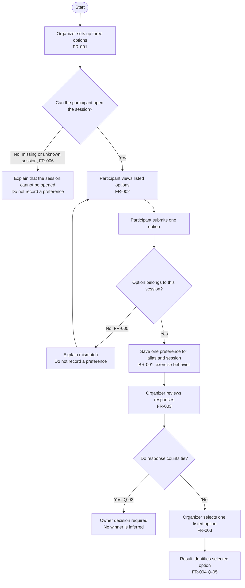
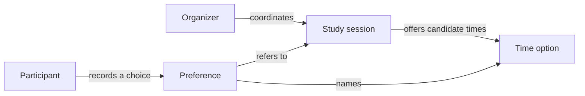

# Group 04 sample outputs — Mermaid, User Flow, and Domain Model

All rules below are sample-only. Diagram syntax can render correctly while the product meaning remains unvalidated.

## `docs/diagrams/README.md` — Topic 07

````markdown
# Diagram samples

Each diagram identifies its question, source requirements, and unresolved
rules. Mermaid rendering checks syntax only; review the semantics against PRD.

## Small Mermaid example: option validation


This is a syntax exercise, not an accepted product rule. Replace the branch
condition and recovery behavior with the project's source-backed requirement.
````

## `docs/user-flow.md` — Topic 08



### شرح التدفق وربطه بمتطلبات PRD

يبدأ المنظّم بإعداد جلسة وثلاثة خيارات متميزة (FR-001). يفتح المشارك الجلسة
ويختار خياراً واحداً من الخيارات التابعة لها (FR-002). قبل التسجيل، يرفض
التمرين الخيار المفقود أو غير المدرج (FR-005) والجلسة المفقودة أو المجهولة
(FR-006)، ولا ينشئ تفضيلاً في هذين المسارين. عند نجاح التحقق، يحفظ النظام
تفضيلاً واحداً للمعرّف المستعار والجلسة (BR-001). يراجع المنظّم الردود ويختار
خياراً مدرجاً (FR-003)، ثم تُظهر النتيجة الخيار المحدد (FR-004). موضع تخزين
الاختيار ومن يمكنه قراءة النتيجة ما زالا سؤالاً مفتوحاً Q-05. إذا تعادلت
الأعداد، يتوقف التدفق عند Q-02 ولا يخترع قاعدة للفصل.

| Diagram path | PRD source | Status |
|---|---|---|
| Set up three options | FR-001 | Exercise choice; no session was created |
| Open session and submit one listed option | FR-002 | Exercise choice; no preference was persisted |
| Reject a missing or unlisted option | FR-005 | Sample validation choice; owner decision pending |
| Reject a missing or unknown session | FR-006 | Sample validation choice; owner decision pending |
| Keep at most one preference per alias/session | BR-001 | Exercise choice; no race or database write was run |
| Review, select, and display one option | FR-003 / FR-004 / Q-05 | Exercise choice; selection storage/viewer access unresolved; no result was saved |
| Resolve a tie | Q-02 | Open; intentionally no winner transition |

This is an authoring flow tied to the fictional PRD, not a runtime trace. No
availability, persistence, retry behavior, owner decision, or visual rendering
has been independently verified.

## `docs/diagrams/domain-model.md` and `.mmd` — Topic 09

````markdown
| Concept | Exercise definition | Relationship | Source/status |
|---|---|---|---|
| Study session | A scheduled group event | Has candidate time options | Exercise vocabulary |
| Organizer | Person coordinating the exercise | Proposes options and selects a time | Exercise role |
| Participant | Person responding to options | Records a preference | Exercise role; identity rules open |
| Time option | One proposed meeting time | Belongs to one session | Exercise choice |
| Preference | Participant’s selected option | Refers to participant and option | Revision rule open |
````



**Review state:** This is a business-concept map, not a class diagram or ERD;
it intentionally carries no implementation fields or cardinalities. Relationship
labels are exercise vocabulary and still need confirmation against a domain
source. No Mermaid renderer or owner review was run for this sample packet.
