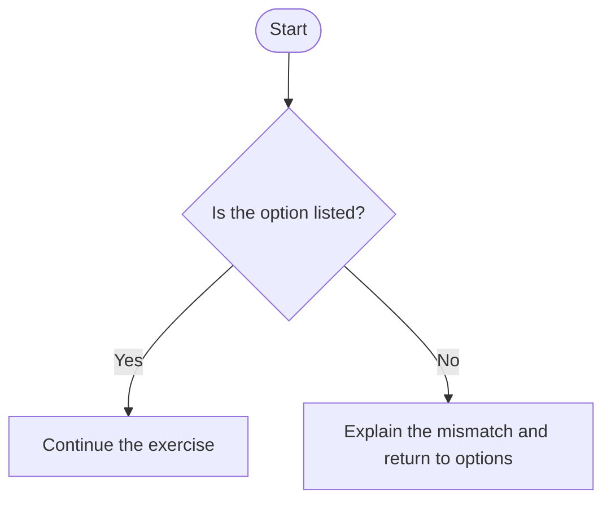
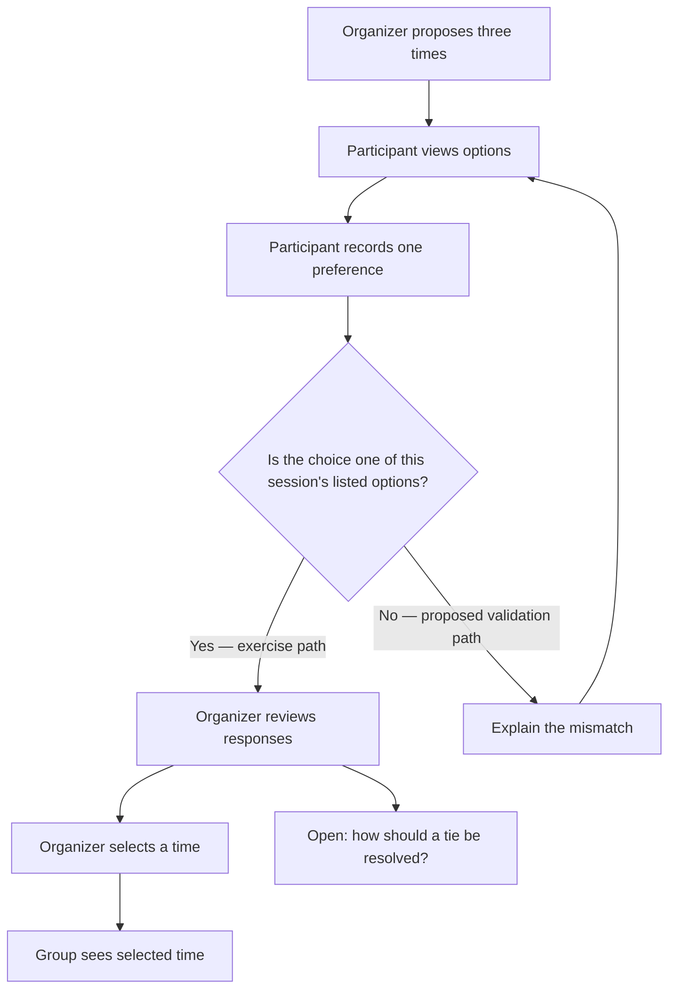
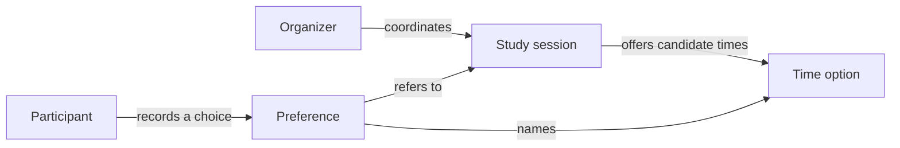

# Group 04 sample outputs — Mermaid, User Flow, and Domain Model

All rules below are sample-only. Diagram syntax can render correctly while the product meaning remains unvalidated.

## `docs/diagrams/README.md` — Topic 07

````markdown
# Diagram samples

Each diagram identifies its question, source requirements, and unresolved
rules. Mermaid rendering checks syntax only; review the semantics against PRD.

## Small Mermaid example: option validation



This is a syntax exercise, not an accepted product rule. Replace the branch
condition and recovery behavior with the project's source-backed requirement.
````

## `docs/user-flow.md` — Topic 08



The validation branch is an explicit exercise proposal, not a product behavior;
replace it with a PRD-backed rule before using the flow for implementation. The
tie node remains an open question. No availability, persistence, or retry
behavior has been executed or independently verified.

## `docs/diagrams/domain-model.md` and `.mmd` — Topic 09

````markdown
| Concept | Exercise definition | Relationship | Source/status |
|---|---|---|---|
| Study session | A scheduled group event | Has candidate time options | Exercise vocabulary |
| Organizer | Person coordinating the exercise | Proposes options and selects a time | Exercise role |
| Participant | Person responding to options | Records a preference | Exercise role; identity rules open |
| Time option | One proposed meeting time | Belongs to one session | Exercise choice |
| Preference | Participant’s selected option | Refers to participant and option | Revision rule open |
````



**Review state:** This is a business-concept map, not a class diagram or ERD;
it intentionally carries no implementation fields or cardinalities. Relationship
labels are exercise vocabulary and still need confirmation against a domain
source. No Mermaid renderer or owner review was run for this sample packet.
