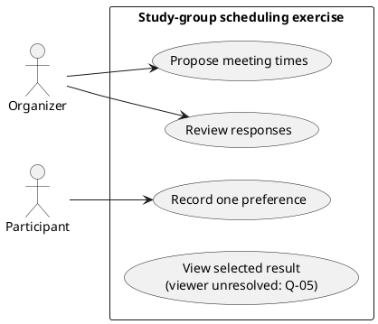
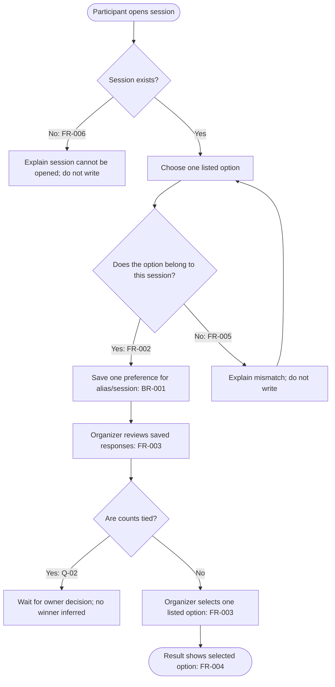
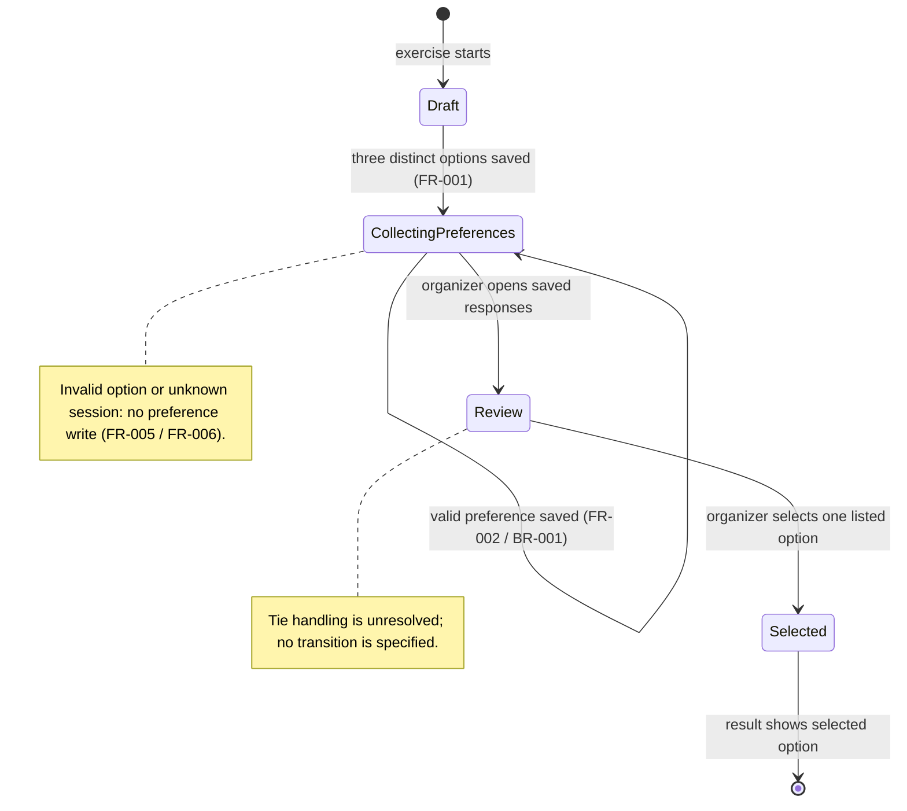

# Group 05 sample outputs — PlantUML and behavior diagrams

These sample diagrams use the fictional study-group scheduling exercise. They state only sample choices; they do not establish real product scope.

## `docs/diagrams/README-plantuml.md` — Topic 10

```markdown
# PlantUML sample

Purpose: practice `@startuml` / `@enduml` and preview a UML diagram.
A successful render checks notation, not whether actors, permissions, or rules
are correct. The links below are candidate editors; no server was used.
```

## `docs/diagrams/use-case.puml` — Topic 11



## `docs/diagrams/use-case.md` — Topic 11 explanation

```markdown
# Use-case explanation — scheduling exercise

The Organizer use cases are to propose three distinct candidate times
(FR-001) and review saved preferences and select one listed option (FR-003).
The Participant use case is to submit one option from the current session
(FR-002). FR-004 requires a selected-result view, but the PRD does not say who
may open it; UC4 is intentionally left without an actor association until
Q-05 is resolved. This does not imply a notification channel. The diagram
records task roles only; it does not define authentication or prove that a
participant is authorized to use a link. Missing/foreign options and missing
sessions are covered by sample validation choices FR-005 and FR-006 in the
separate flow model; they are not actor permissions. Tie handling remains
Q-02. Result storage and visibility remain Q-05.

Status: static explanation of fictional exercise requirements. No use case was
executed, independently validated, or accepted by a product owner.
```

## `docs/diagrams/activity-diagram.mmd` — Topic 12 (Mermaid flowchart)



## `docs/diagrams/activity-diagram.md` — Topic 12 explanation

```markdown
# Activity explanation — recording a preference

The participant opens a session (FR-006), chooses one of its listed options,
and submits it. Under the exercise rule, the service checks that the option
belongs to that session (FR-002). If valid, it saves one preference for the
alias and session (BR-001); the organizer can later review saved responses and
select an option (FR-003). The alternative paths represent the sample
validation choices: an invalid option (FR-005) or missing/unknown session
(FR-006) produces no write and returns an explanation. The activity diagram is
not an executed workflow.

The winning/losing response for simultaneous duplicates, edit behavior, and
storage-error copy remain open under Q-01/Q-04. Tie handling remains Q-02. No
retry policy or service implementation is inferred here.
```

## `docs/diagrams/state-diagrams.mmd` — Topic 13 (Mermaid stateDiagram-v2)



## `docs/diagrams/state-diagrams.md` — Topic 13 transition table and explanation

```markdown
# State model — StudySession exercise

The state diagram follows the session through option collection, response
review, and selection. A valid participant preference is saved while the
session remains in CollectingPreferences; the repeated-state transition does
not imply a new session state per preference. It aligns the diagram with the
PRD/SRS sample's stored-preference behavior (FR-002 / BR-001). The selected
result is the next logical state after the organizer chooses an option, but
where that choice is stored and who can read it remain Q-05; no storage
mechanism is inferred by this diagram.

| Current state | Trigger / guard | Next state | Requirement / evidence |
|---|---|---|---|
| Draft | Organizer saves three distinct options | CollectingPreferences | FR-001; exercise choice |
| CollectingPreferences | Participant submits listed option; same session verified and preference saved | CollectingPreferences | FR-002 / BR-001; no service/database write was run |
| CollectingPreferences | Organizer opens saved responses | Review | FR-003; exercise choice |
| Review | Organizer selects one listed option | Selected | FR-003; tie rule Q-02 and selection storage Q-05 remain open |
| Selected | Result view identifies the selected option | End | FR-004; storage/viewer policy Q-05; no result screen was rendered |
| Any participant submission | Option missing/foreign or session missing/unknown | No transition; reject without write | FR-005 / FR-006; sample validation choices |

The diagram is a static exercise model. It does not specify persistence
technology, editing, concurrency responses, tie resolution, or retry behavior.
No state transition or Mermaid rendering was run against an application.
```

These Mermaid snippets match the expected `.mmd` outputs. They are sample
states and transitions only; persistence technology, rejection/recovery, and
rendering have not been validated against a real product or renderer.

**Review state:** The Topic 11 use-case example above is the only PlantUML
diagram in this group. Its rendering, UML correctness, role authority, and
source traceability have not been independently checked.
