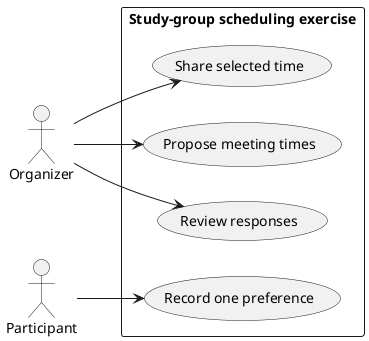
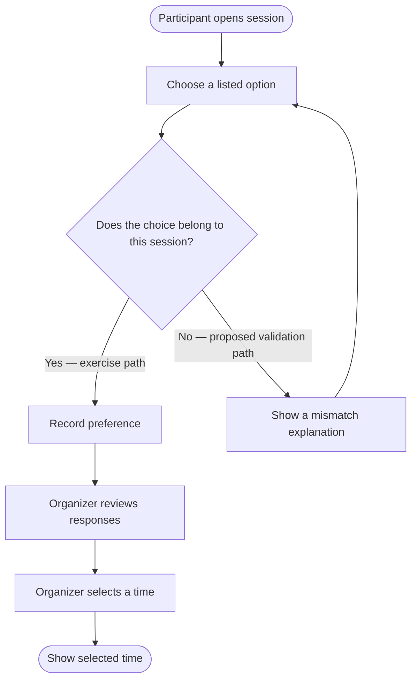
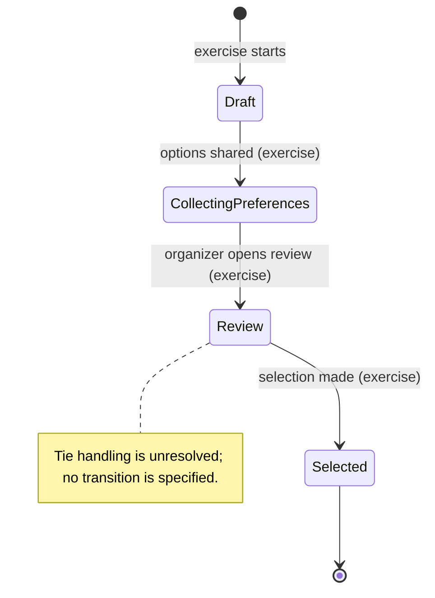

# Group 05 sample outputs — PlantUML and behavior diagrams

These sample diagrams use the fictional study-group scheduling exercise. They state only sample choices; they do not establish real product scope.

## `docs/diagrams/README-plantuml.md` — Topic 10

```markdown
# PlantUML sample

Purpose: practice `@startuml` / `@enduml` and preview a UML diagram.
A successful render checks notation, not whether actors, permissions, or rules
are correct. The links below are candidate editors; no server was used.
```

## `docs/diagrams/use-case.puml` — Topic 11



## `docs/diagrams/activity-diagram.mmd` — Topic 12 (Mermaid flowchart)



The invalid-choice branch is an exercise proposal for demonstrating a guard and
recovery path. Replace it with source-backed behavior before using this as a
product model. The tie rule remains open and is not modeled as a transition.

## `docs/diagrams/state-diagrams.mmd` — Topic 13 (Mermaid stateDiagram-v2)



These Mermaid snippets match the expected `.mmd` outputs. They are sample
states and transitions only; event names, persistence, rejection/recovery, and
rendering have not been validated against a real product or renderer.

**Review state:** The Topic 11 use-case example above is the only PlantUML
diagram in this group. Its rendering, UML correctness, role authority, and
source traceability have not been independently checked.
