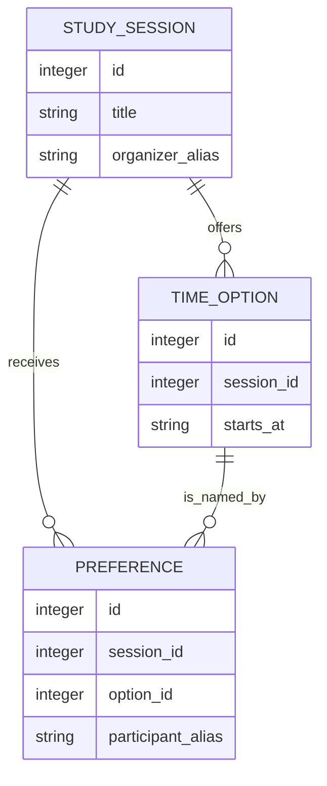
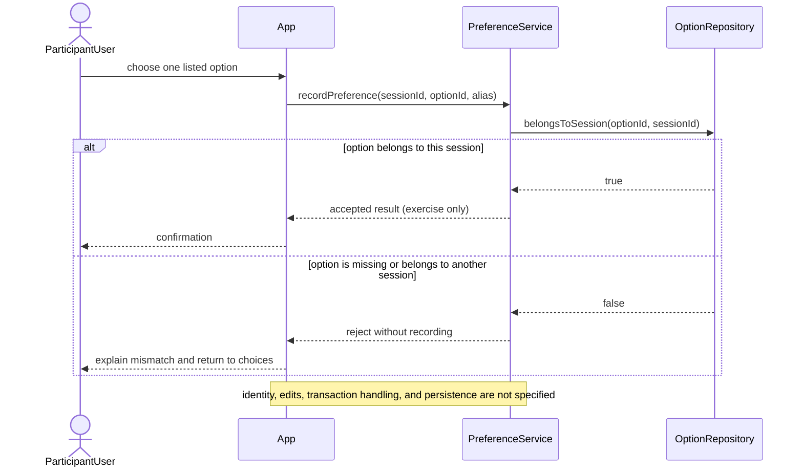
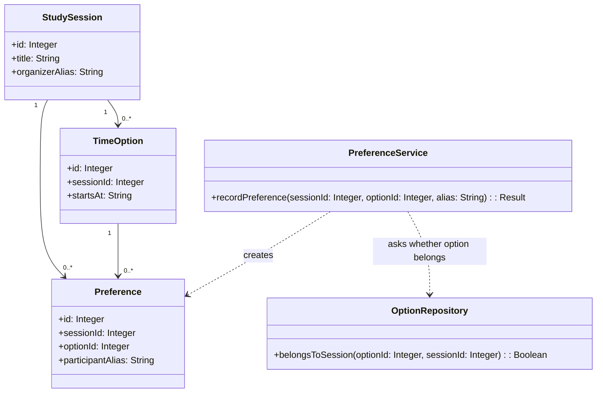

# Group 06 sample outputs — ERD, DBML, Sequence, and Class diagrams

This data model makes explicit exercise choices for a fictional scheduler. It does not assert production requirements. No DBML parser, diagram service, generated-DDL workflow, or PostgreSQL tool was executed. A narrow manually translated SQLite semantics probe is recorded below.

## `docs/ERD.md` — Topic 14

````markdown
# Relational design exercise

Provisional entities: StudySession, TimeOption, Preference. The participant
alias is currently an attribute on Preference, not a separate entity; confirm
identity scope before promoting it to a domain concept. Exercise-only choices:
each option belongs to one session; one alias can record one preference per
session. Confirm these cardinalities before using them as product requirements.



The ERD expresses the exercise's one-parent/zero-or-more-child reading; it
does not show the composite same-session constraint. That rule is represented
in `docs/database.dbml` by the composite foreign key and must be preserved when
translating or generating a physical schema. The minimum number of options is
zero in this draft. No parser or renderer checked this Mermaid ERD.
````

## `docs/database-review.md` — Topic 14

```markdown
# Database review — fictional scheduling exercise

Status: static design review of the sample only. No production requirements
or database engine have been approved.

| Scenario / constraint | What the draft protects | Remaining risk or question |
|---|---|---|
| Preference references an option from the same session | The composite `(session_id, option_id)` foreign key prevents a cross-session reference when translated to a database that enforces it. | DBML syntax and generated DDL still need a parser/export check for the selected tool. |
| Same alias submits twice for one session | `UNIQUE(session_id, participant_alias)` allows at most one stored preference for that sample alias/session pair. | An alias is not a verified person. Edit, conflict response, and retry behavior remain open. |
| Two duplicate submissions race | The unique constraint should preserve the one-row invariant in the target database. | The losing request's response and retry behavior are application decisions; no concurrent application test was run. |
| Two options receive the same number of preferences | No schema constraint selects a winner. | Tie handling remains an owner question and must not be inferred from this model. |
| Meeting time is stored as text | The column can hold the exercise value. | Format, timezone, normalization, and display rules are unresolved. |

## Probe evidence and limits

Root reported a separate in-memory SQLite probe against manually translated DDL:
same-session preference accepted, cross-session option rejected by the foreign
key, duplicate alias/session preference rejected by the unique constraint.
This is evidence for those constraints in that translated SQLite schema only.
It does not validate this DBML, a diagram-service export, PostgreSQL, a live
application race, or user-facing error behavior.
```

This is a written review artifact. No concurrency test or production database
was run by this sample packet.

## `docs/database.dbml` — Topic 15

```dbml
Table study_session {
  id integer [pk]
  title varchar [not null]
  organizer_alias varchar [not null]
}

Table time_option {
  id integer [pk]
  session_id integer [not null]
  starts_at varchar [not null, note: 'Exercise format; timezone unresolved']

  indexes {
    (session_id, id) [unique]
  }
}

Table preference {
  id integer [pk]
  session_id integer [not null]
  option_id integer [not null]
  participant_alias varchar [not null]

  indexes {
    (session_id, participant_alias) [unique]
  }
}

Ref: time_option.session_id > study_session.id
Ref: preference.session_id > study_session.id
Ref: preference.(session_id, option_id) > time_option.(session_id, id)
```

The unique preference index encodes the exercise choice that each participant submits one preference per session. The composite reference makes it impossible for a preference to name a session and an option belonging to a different session. The unique `(session_id, id)` index is the referenced key. This DBML composite-reference syntax, generated SQL, and constraint behavior still need verification in the selected diagram service and database.

**Independent narrow probe — root, 2026-10-20:** Using one-off in-memory SQLite DDL manually translated from this sample, a same-session preference was accepted, a cross-session option was rejected by the foreign key, and a duplicate participant/session preference was rejected by the unique constraint. This verifies those relational semantics only for the manually translated DDL. DBML parsing, generated-DDL equivalence, PostgreSQL execution, and repository-level tests remain **Not Run**.

## `docs/database.sql` — Topic 15 (hand-transcribed preview)

The following is an illustrative SQL translation of the DBML above so a learner
can compare tables and constraints. It was **not** exported by dbdiagram.io or
another diagram service and was not executed as part of this packet. Replace it
with the selected tool's actual export before calling the learner output
complete.

```sql
PRAGMA foreign_keys = ON;

CREATE TABLE study_session (
  id INTEGER PRIMARY KEY,
  title VARCHAR NOT NULL,
  organizer_alias VARCHAR NOT NULL
);

CREATE TABLE time_option (
  id INTEGER PRIMARY KEY,
  session_id INTEGER NOT NULL,
  starts_at VARCHAR NOT NULL,
  UNIQUE (session_id, id),
  FOREIGN KEY (session_id) REFERENCES study_session(id)
);

CREATE TABLE preference (
  id INTEGER PRIMARY KEY,
  session_id INTEGER NOT NULL,
  option_id INTEGER NOT NULL,
  participant_alias VARCHAR NOT NULL,
  UNIQUE (session_id, participant_alias),
  FOREIGN KEY (session_id) REFERENCES study_session(id),
  FOREIGN KEY (session_id, option_id)
    REFERENCES time_option(session_id, id)
);
```

The `PRAGMA` is SQLite-specific and is included only to make SQLite foreign-key
enforcement explicit in this illustrative translation. DDL generation, engine
compatibility, and equivalence with a real export remain **Not Run**.

## Sequence and class excerpts — Topics 16–17





| Sequence message | Class operation | Contract role |
|---|---|---|
| `recordPreference(sessionId, optionId, alias)` | `PreferenceService.recordPreference(...)` | Accepts a proposed preference and returns a result. |
| `belongsToSession(optionId, sessionId)` | `OptionRepository.belongsToSession(...)` | Checks the same-session invariant before recording. |
| stored preference / reject | `Result` | Distinguishes the two illustrative outcomes; no concrete API or persistence behavior is claimed. |

**Cardinality note:** A session may have zero options while it is being drafted; this sample does not promise that a session must contain an option. The class diagram and DBML therefore both use zero-or-more. A future product rule that blocks publication until an option exists would need a separate, explicitly validated service rule.

**Review state:** Root's narrow SQLite semantics probe passed for the described FK and uniqueness behavior. Schema rendering, DBML composite-reference parsing, generated DDL equivalence, PostgreSQL behavior, and class ownership have not been checked. Revisit the sample when ERD cardinalities are confirmed.
